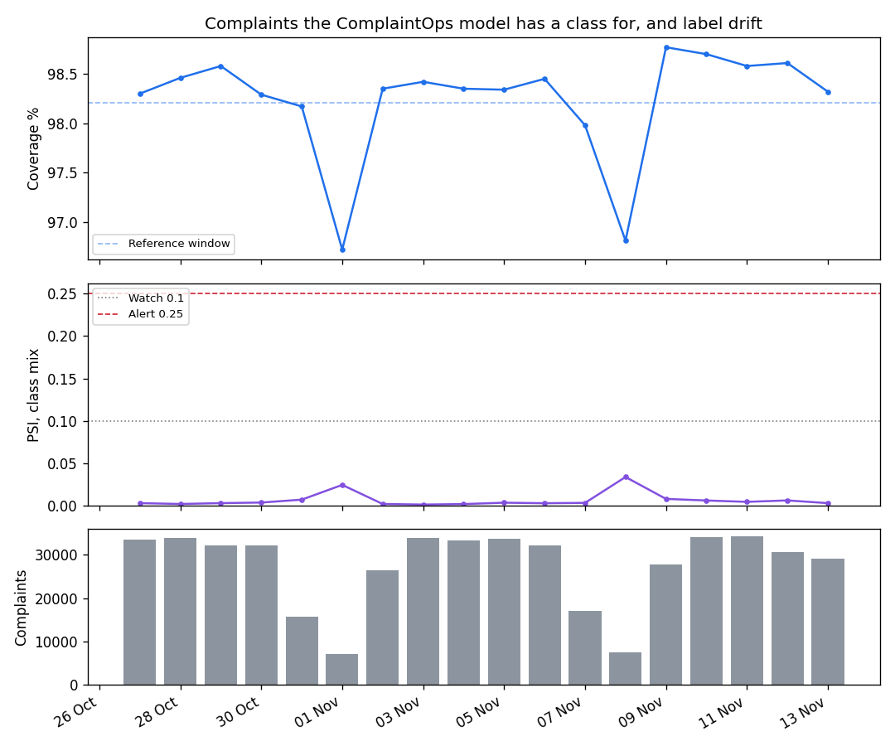
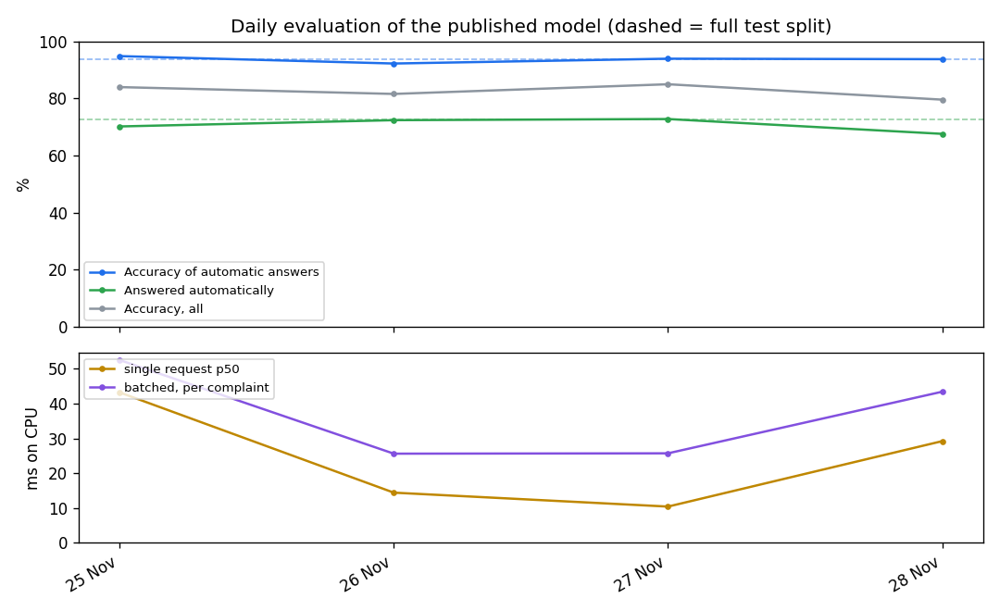

# ComplaintOps Live

A daily check on whether the world my [ComplaintOps](https://github.com/hardikbahri/complaintops) complaint-triage model was trained on still looks like the world it would serve.

ComplaintOps classifies US consumer financial complaints into 24 product + issue classes (DistilBERT + LoRA, int8 ONNX, [on Hugging Face](https://huggingface.co/hb-007/complaintops-distilbert-lora-onnx)). Background in the article: [My LLM was confident 99% of the time. It was right 39% of the time.](https://medium.com/@hardik.bahri/my-llm-was-confident-99-of-the-time-it-was-right-39-of-the-time-84c6fc2e34f3)

Every morning a GitHub Actions job:

1. counts the complaints the CFPB received 15 days earlier (late publications have landed by then), by product and issue, from the [public complaint API](https://cfpb.github.io/api/ccdb/),
2. maps every product + issue onto the model's 24 classes, with the same mapping used in training and the class list read from the model's `classes.json`,
3. measures **coverage** (share of complaints the model has a class for) and **label drift** (PSI of the class mix against a 28-day reference window),
4. commits the day's counts, a short report and this dashboard.

Why labels and not predictions: the CFPB has stopped publishing complaint narratives in its public data, so there is no new text to run the model on. The product and issue the consumer picks are still published, and they are exactly what the model predicts. A drop in coverage means new kinds of complaints the model can't name; a rising PSI means the class mix (and the priors behind the model's calibration offsets) has moved, which is the signal to re-check thresholds or retrain.

Reports below are generated automatically by the daily job.

## Dashboard

<!-- LIVE:START -->
**Last run:** 2026-11-28 | **Latest receipt date checked:** 2026-11-13 | **Status:** OK

Reference window: complaints received 2026-09-29 to 2026-10-26 (677,358 complaints, 98.2% covered by the model's classes).

| Received | Complaints | Coverage | PSI class mix | Largest class | Status |
| --- | --- | --- | --- | --- | --- |
| [2026-11-13](reports/2026-11-13.md) | 29,049 | 98.3% | 0.003 | Credit reporting / Dispute, accuracy or use of report (92.6%) | OK |
| [2026-11-12](reports/2026-11-12.md) | 30,609 | 98.6% | 0.006 | Credit reporting / Dispute, accuracy or use of report (93.6%) | OK |
| [2026-11-11](reports/2026-11-11.md) | 34,202 | 98.6% | 0.004 | Credit reporting / Dispute, accuracy or use of report (93.4%) | OK |
| [2026-11-10](reports/2026-11-10.md) | 33,970 | 98.7% | 0.006 | Credit reporting / Dispute, accuracy or use of report (93.5%) | OK |
| [2026-11-09](reports/2026-11-09.md) | 27,740 | 98.8% | 0.008 | Credit reporting / Dispute, accuracy or use of report (93.8%) | OK |
| [2026-11-08](reports/2026-11-08.md) | 7,552 | 96.8% | 0.034 | Credit reporting / Dispute, accuracy or use of report (86.8%) | OK |
| [2026-11-07](reports/2026-11-07.md) | 16,967 | 98.0% | 0.003 | Credit reporting / Dispute, accuracy or use of report (91.5%) | OK |
<!-- LIVE:END -->

## Daily model evaluation

The CFPB data no longer has complaint text, so the model is also checked another way: every day the published int8
ONNX model classifies 500 complaints sampled (seeded by the date) from the held-out test split, the newest 15% of the
ComplaintOps data that the model never trained on. This catches a broken model upload, a tokenizer mismatch or a slow
runtime within a day, and tracks CPU latency on a standard GitHub runner.

<!-- EVAL:START -->
**Latest (2026-11-28):** 500 held-out complaints, accuracy 79.6%, answered automatically 67.6% at 93.8% accuracy, 29.2 ms per request (p50, CPU).

| Date | Accuracy | Auto-answered | Accuracy (auto) | p50 ms |
| --- | --- | --- | --- | --- |
| [2026-11-28](reports/eval/2026-11-28.md) | 79.6% | 67.6% | 93.8% | 29.2 |
| [2026-11-27](reports/eval/2026-11-27.md) | 85.0% | 72.8% | 94.0% | 10.4 |
| [2026-11-26](reports/eval/2026-11-26.md) | 81.6% | 72.4% | 92.3% | 14.4 |
| [2026-11-25](reports/eval/2026-11-25.md) | 84.0% | 70.2% | 94.9% | 43.2 |
<!-- EVAL:END -->

## Status rules

| Status | Meaning |
| --- | --- |
| OK | PSI below 0.10 and coverage within 5 points of the reference window |
| WATCH | PSI 0.10 to 0.25, or coverage 5 to 10 points below reference |
| ALERT | PSI above 0.25, or coverage more than 10 points below reference |
| LOW VOLUME | fewer than 200 complaints that day |

## Layout

- `monitor/run.py`: the daily job
- `monitor/labels.py`: maps CFPB product and issue to the model's classes (same mapping as training)
- `data/daily/`: one CSV per receipt date (product, issue, model class, complaint count)
- `reports/`: one markdown report per receipt date, plus `trend.png`
- `history.csv`: one row per receipt date
- `monitor/evaluate.py`, `eval_history.csv`, `reports/eval/`: the daily model evaluation
- `data/eval/test.jsonl.gz`: the held-out test split (CFPB public complaints, already redacted by the CFPB)
- `state/baseline.json`: the frozen reference window

Run it yourself: `pip install -r requirements.txt && python -m monitor.run`
